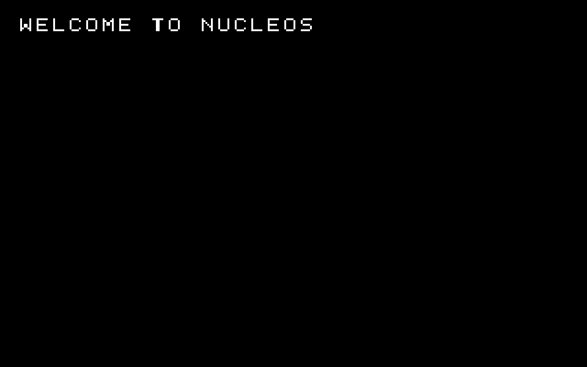

# Day 13 verification evidence

Verification performed on October 31, 2026 on branch `codex/day13-audit`.

[results.json](results.json) records exact argument arrays, working directories
and exit codes. Each step has separate stdout and stderr captures. Trailing
spaces were removed from four lines of the saved readelf stdout for Git whitespace
hygiene; no diagnostic content was changed:

| Step | stdout | stderr |
| --- | --- | --- |
| Full kernel build | [kernel](kernel-stdout.txt) | [kernel](kernel-stderr.txt) |
| ISO creation | [iso](iso-stdout.txt) | [iso](iso-stderr.txt) |
| ELF inspection | [readelf](readelf-stdout.txt) | [readelf](readelf-stderr.txt) |
| Headless BIOS boot | [qemu](qemu-stdout.txt) | [qemu](qemu-stderr.txt) |

The [E9 trace](e9.txt) was copied from this QEMU run's output file.

## Source isolation

A new `build/day13-final-verification/source/` directory was populated from
`git ls-files --cached --others --exclude-standard -z` in the active worktree.
[Source files](source-files.txt) lists the copied inputs. This includes reviewed
uncommitted Day 13 files and worktree contents, not just HEAD. Ignored downloads,
old outputs, ISO staging directories and nested Limine source were excluded.
The current report directory was created after copying, so it is not in that
snapshot. Later documentation updates do not change the build inputs.

Python `subprocess.run(..., capture_output=True)` executed each command with
separate streams and saved its `returncode`; no shell pipeline masked failures.

The kernel build uses `make -B all` in the fresh source tree. The subsequent
`make iso` reuses those objects and records ISO-tool diagnostics separately.
Kernel stderr is empty and its exit code is 0: no GCC or GNU ld warnings were
emitted by this invocation. This statement concerns the current flags, not all
possible compiler diagnostics. ISO stderr contains xorriso progress and Limine
hybrid-table/active-partition diagnostics; it is not empty and must not be
reported as a warning-free run of every tool.

QEMU is bounded by `timeout 15s`; status 124 records planned termination.
The complete E9 sequence supplies boot-path evidence. After these tests, the
user confirmed on October 31, 2026 that QEMU displayed `WELCOME TO NUCLEOS`.
This initial confirmation was a user report, not an agent visual inspection or
screenshot. The candidate-source runs above do not test UEFI or a committed clean
clone; the subsequent independent clean-clone evidence is recorded below.

## Independent clean-clone audit and framebuffer evidence

The user reported Claude Code's final audit as approved with observations:
a clean clone of commit `e8627b5a0aba35426cba221715df46a248e9986b` built
without warnings, generated the ISO, booted in BIOS QEMU and emitted all seven
E9 markers. This is a separate audit from the candidate-source tests above.

The surviving audit directory `day13-clean-clone/` contains `repo/` at exactly
that commit with a clean Git status, and `logs/`. Its `make.err` is empty;
`e9-screen.log` contains all seven expected markers. The monitor transcript
`qemu-screen.out` records `screendump .../logs/screen.png -f png` followed by
`quit`. The original PNG was copied byte for byte into this report; no image
editing or generation was performed. The agent inspected the PNG and observed
`WELCOME TO NUCLEOS`. The clean-clone execution was performed by Claude Code,
not rerun by this agent during publication preparation.

Capture: real QEMU framebuffer screendump, PNG RGB, 1280 × 800, from the ISO
built in that clean clone on October 31, 2026. Source: the audit's
`day13-clean-clone/logs/screen.png`.

SHA-256: `72f2e63e19cdf645dffe2b8d2819a644940ee22d8362f625bf4552cac2a4ff8b`.

UEFI boot, byte-for-byte reproducible ISO output and authenticity of the original
Limine archive remain unverified. This capture does not establish those claims.
